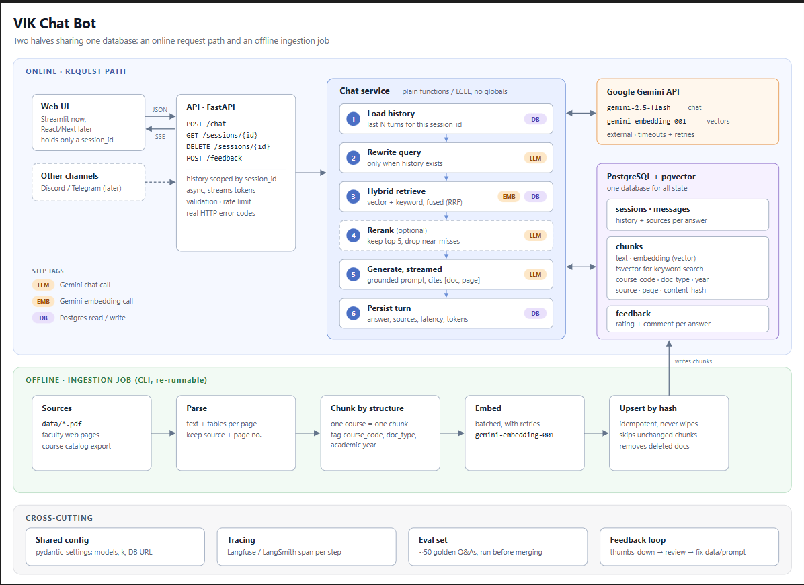

# VIK ChatBot

An AI-powered assistant for BME VIK students that uses RAG (Retrieval-Augmented Generation)
to answer university-related questions (courses, requirements, regulations, schedules) with
answers grounded in official faculty documents and cited as `[document, page]`.

> **Status: skeleton.** The directory layout and each directory's responsibilities are
> defined. No implementation exists yet. Every directory has its own `README.md` describing
> what belongs there.



## Architecture at a glance

The system has two halves that share **one PostgreSQL + pgvector database**.

### Online: request path

`Web UI → FastAPI → Chat service → (Google Gemini API, PostgreSQL)`

The chat service runs each user turn through a pipeline of plain functions (no globals):

| # | Step                | What it does                                            | Calls      |
|---|---------------------|---------------------------------------------------------|------------|
| 1 | Load history        | Last N turns for this `session_id`                      | DB         |
| 2 | Rewrite query       | Turns a follow-up into a standalone question; runs only when history exists | LLM        |
| 3 | Hybrid retrieve     | Vector + keyword search, fused with Reciprocal Rank Fusion (RRF) | EMB, DB    |
| 4 | Rerank *(optional)* | Keeps the top 5, drops near-misses                      | LLM        |
| 5 | Generate, streamed  | Grounded prompt, cites `[doc, page]`, streams tokens     | LLM        |
| 6 | Persist turn        | Stores answer, sources, latency, token counts           | DB         |

### Offline: ingestion job (re-runnable CLI)

`Sources → Parse → Chunk by structure → Embed → Upsert by hash`

Idempotent: unchanged chunks are skipped, deleted documents are removed, and the table is
never wiped.

### Cross-cutting

- **Shared config**: one `pydantic-settings` object (model names, `k`, DB URL).
- **Tracing**: a Langfuse / LangSmith span for every pipeline step.
- **Eval set**: about 50 golden Q&As, run before merging.
- **Feedback loop**: a thumbs-down answer is reviewed, then the data or prompt is fixed.

## Repository layout

```
vik-chatbot/
├── src/vik_chatbot/        # The Python package (all server-side code)
│   ├── config/             # Shared settings (pydantic-settings), the only place config is read
│   ├── api/                # FastAPI app: routes, request/response schemas, errors, rate limit
│   ├── chat/               # Chat service: the 6-step per-turn pipeline
│   ├── retrieval/          # Hybrid search (vector + keyword), RRF fusion, optional reranker
│   ├── llm/                # Gemini chat and embedding clients with timeouts and retries
│   ├── prompts/            # Prompt templates (rewrite, rerank, grounded generation)
│   ├── db/                 # DB models and repositories: sessions, messages, chunks, feedback
│   ├── ingestion/          # Offline CLI: sources → parse → chunk → embed → upsert
│   └── observability/      # Tracing (Langfuse/LangSmith), logging, metrics
├── ui/                     # Web UI (Streamlit now, React/Next later), an API client only
├── channels/               # Future Discord / Telegram bots, also API clients
├── migrations/             # Alembic migrations: schema, pgvector extension, indexes
├── data/                   # Raw source documents for ingestion (contents git-ignored)
├── evals/                  # Golden Q&A set and the evaluation runner
├── tests/                  # Unit and integration tests
├── scripts/                # Developer and operations helper scripts
├── deploy/                 # Dockerfiles and docker-compose (Postgres+pgvector, API, UI)
└── docs/                   # Architecture diagram, design notes, decision records
```

### Dependency rules

- `api` → `chat` → `retrieval`, `llm`, `db`, `prompts`
- `ingestion` → `llm`, `db`
- Every module may import `config` and `observability`.
- Nothing imports `api`. `ui/` and `channels/` talk to the system **only over HTTP**.

## Tech stack

| Concern        | Choice                                         |
|----------------|------------------------------------------------|
| Language       | Python 3.11+                                   |
| API            | FastAPI (async, SSE streaming)                 |
| LLM            | Google Gemini: `gemini-2.5-flash` for chat     |
| Embeddings     | Google Gemini: `gemini-embedding-001`          |
| Database       | PostgreSQL + pgvector (vectors) + `tsvector` (keyword search) |
| Orchestration  | Plain functions / LangChain Expression Language (LCEL) |
| Config         | pydantic-settings                              |
| Tracing        | Langfuse or LangSmith                          |
| UI             | Streamlit (React/Next.js later)                |

## Getting started

_TODO: fill in once the first implementation lands._

```bash
uv venv && source .venv/bin/activate
uv pip install -e ".[dev,ui]"        # extras: dev, ui, tracing, eval
cp .env.example .env                 # then set GEMINI_API_KEY
```

1. Start Postgres with pgvector (`deploy/`).
2. Check `DATABASE_URL` in `.env` matches the database.
3. Apply migrations (`migrations/`).
4. Put source documents in `data/` and run the ingestion CLI.
5. Start the API, then the UI.

## License

See [LICENSE](LICENSE).
